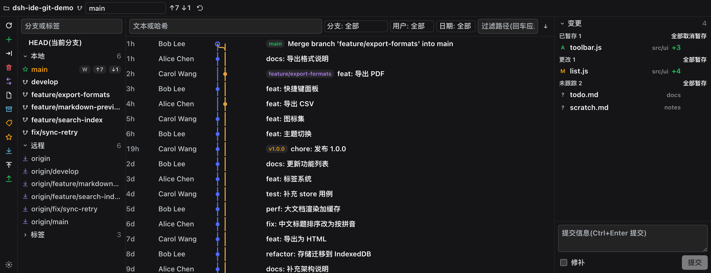
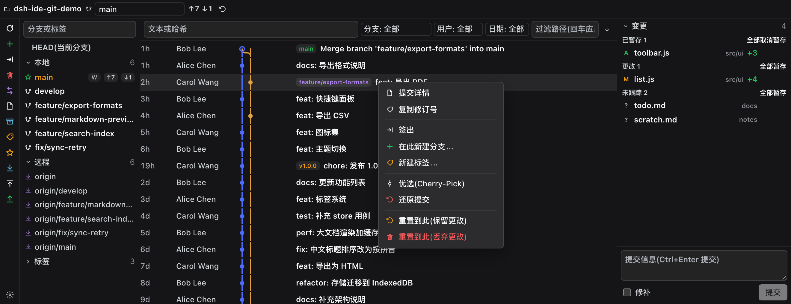
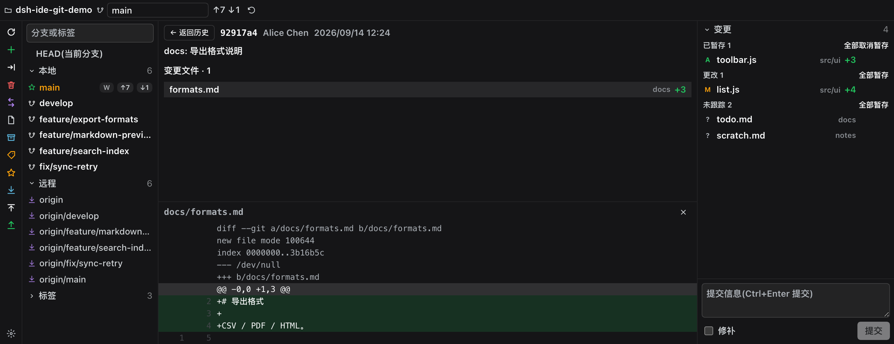
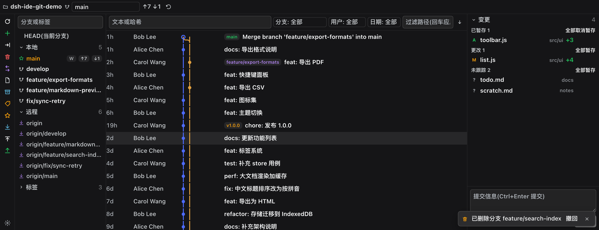
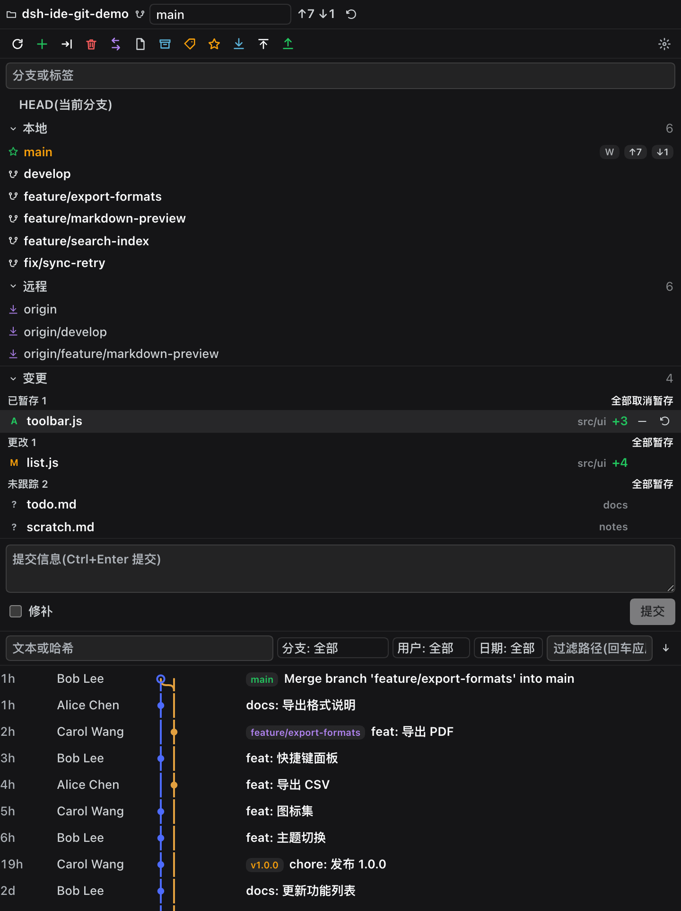
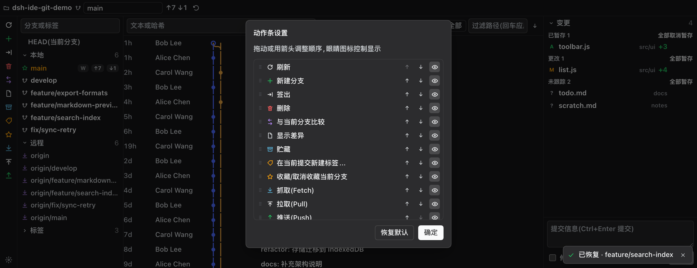

# dsh-ide-git

[](https://awesome-dsh-plugin.com)

简体中文 | [English](README_EN.md)

> 给 DeepSeek Harness 的 Git 工具窗口：分支树、提交图谱、变更与提交、逐行 diff 都在同一个面板里，操作方式对齐 JetBrains 系 IDE。

DSH 内置的 Git 面板覆盖暂存、提交、还原和历史。这个插件把 IDE 里常见的 Git 工具窗口搬进来：分支树与右键操作、提交图谱、提交详情与逐行 diff、多仓概览。它注册为 `dsh-better-sidebar` 的原生 Tab，也能直接挂在 DSH 原生右侧栏；v0.13.0 起还可以作为主对话区的 Git 标签页。

**目录**

- [它是什么](#它是什么)
- [安装与打开](#安装与打开)
- [截图](#截图)
- [核心用法](#核心用法)
  - [分支与历史](#分支与历史)
  - [提交、差异与引用](#提交差异与引用)
  - [变更、暂存与提交](#变更暂存与提交)
  - [全部仓库](#全部仓库)
  - [发送到对话](#发送到对话)
- [界面与设置](#界面与设置)
  - [挂在哪里](#挂在哪里)
  - [布局与动作条](#布局与动作条)
  - [输入框里的 Git](#输入框里的-git)
  - [设置与诊断](#设置与诊断)
- [兼容性与限制](#兼容性与限制)
  - [兼容性](#兼容性)
  - [界面语言](#界面语言)
  - [已知限制](#已知限制)
- [开发](#开发)
  - [实现](#实现)
- [许可](#许可)

## 它是什么

它是一个面板，不是一组命令。宽布局里左边是分支树，中间是提交图谱，右边是变更与提交框；容器变窄时自动改为纵向堆叠。同一个面板会出现在右侧栏、底部工作台或主对话区，布局按容器宽度自适应。

和内置面板的关系：

| 维度 | DSH 内置 Git 面板 | dsh-ide-git |
|---|---|---|
| 定位 | 暂存、提交、还原、历史 | IDE 风格的 Git 工具窗口 |
| 分支 | 一个下拉 | HEAD / 本地 / 远程 / 标签树，带右键操作 |
| 历史 | 列表 | 图谱、范围切换、过滤、框选 |
| 多仓 | 需要来回切仓 | 「全部仓库」概览，一仓一卡 |
| 代码引用 | 无 | 右键把提交、分支、文件或 diff 行发进对话 |

两者可以同时存在，本插件不替换内置面板。

## 安装与打开

要求：DSH `>=0.2.2-rc.1`。本版本只在 `web` profile 做了完整验证；桌面端复用同一套渲染器，但未做真机验证（见「已知限制」）。

```sh
dsh plugin --profile web add dsh-ide-git

# 可选：底部工作台 + better-sidebar 的侧栏外壳
dsh plugin --profile web add dsh-better-sidebar

# 重启 dsh web
```

打开方式：

- 只装本插件：会话头右侧「打开右侧边栏」→ Guide 页的 **Git** 胶囊。
- 装了 better-sidebar：底部面板 `+` → **Git**；或原生右侧栏 `+` → **Git**。两者是同一注册、同一份状态。
- 主对话区：会话顶部「对话 / 轨迹」旁的 **Git** 标签。不需要时可在插件设置里关掉。

## 截图



*底部工作台：左列动作条，中间提交图谱，右列变更与提交框。*

| | |
|---|---|
| <br/>**提交右键**：详情、复制修订号、签出、新建分支 / 标签、cherry-pick、还原、重置。 | <br/>**提交详情**：完整信息、作者 / 日期、文件列表与逐行 diff。 |
| <br/>**删除可撤回**：删除分支或贮藏后 30 分钟内可恢复。 | <br/>**右侧栏**：窄而高时自动改成堆叠布局。 |

<details>
<summary>更多截图</summary>



*动作条设置：拖动排序、逐项显隐。*

</details>

## 核心用法

### 分支与历史

- **分支树**：`HEAD`、本地、远程、标签四组，可折叠、可过滤；每个分支显示 ahead/behind、上游和 worktree 占用标记 `W`。本地蓝、远程紫、标签黄、HEAD 绿。
- **历史图谱**：lane 拓扑连线跨行对齐，HEAD 是空心点，refs 徽章最多显示 3 个，多出的收成 `+n`。每页 120 条，滚到底自动加载；分支、提交和文件列表都支持框选批量选中。
- **范围**：历史可以在当前分支、全部分支、任意本地或远程分支之间切换。别的分支领先的提交不会因为不在当前祖先链上而消失。双击分支直接浏览它的历史，不强制签出；有合并关系时定位到最近的合并点。
- **过滤**：文本或哈希、分支或标签、提交人（含「我」）、日期（今天 / 近 7 天 / 近 30 天 / 今年），可切换新→旧 / 旧→新，一键清除。路径过滤回车后由 git 服务端执行 `git log -- <path>`。
- **分支右键**：签出、变基当前到此、合并此分支到当前、比较、从该分支新建、重命名、删除、Fetch、Push、发送到对话。菜单和合并按钮直接写出两端分支名，例如「将当前 master 变基到 test」「合并 test 到当前 master 分支」；变基开始时有提示条。合并可选默认 / `--no-ff` / `--squash` / `--no-ff --no-commit`；比较结果按文件和提交数汇报。挂起的 no-commit 合并可在「更多操作 → 提交 → 中止合并」退出。
- **工作树**：动作条里的「工作树」列出主工作树和链接工作树（当前 / 主 / 锁定 / 可清理、分支、短 HEAD、路径），可新建（新分支或挂已有分支，可指定起点）、在面板中打开、复制路径、移除（有未提交改动要二次强制确认）、清理失效记录。它和官方「变更请求」面板并存。
- **常用动作**：动作条里还有刷新、新建分支、签出、删除、比较、显示差异、收藏、贮藏（列表 / 保存 / 应用 / 删除）、标签、Fetch、Pull --ff-only、Push 等；每个按钮按当前状态点亮或置灰，悬停会说明为什么不能点。

### 提交、差异与引用

- **提交列表**：列序对齐 IDEA：日期 → 提交人 → 图谱 → 分支标签 → 提交信息。日期默认相对时间，可在设置里改成绝对时间。
- **提交详情**：完整提交信息、作者 / 日期、变更文件列表（带 +/−），点文件看逐行 diff（行号、hunk 高亮、红绿底）。
- **提交右键**：详情、复制修订号、签出该修订（确认）、在此新建分支、新建标签、cherry-pick、还原提交、重置到此（保留 / 丢弃更改）、发送到对话。
- **diff**：支持左右分栏 / 自动换行、复制、拖拽调高并按位置记忆；默认在面板内打开。设置里的「差异打开位置」可选 Git 面板内 / 右侧栏 / 底部工作台，选后双击文件落到对应位置；内嵌头部还有「在右侧栏打开」，多文件补丁会跟随当前文件，没有右侧栏或差异还在加载时按钮禁用并说明原因。
- **路径操作**：diff 头部完整路径按 `/` 分段，悬停高亮；右键任一级目录可丢弃该目录下全部更改或加入 `.gitignore`（仅未跟踪内容），最后一段文件可单独丢弃或加入 `.gitignore`。
- **选中行发到对话**：在 diff 里选中一段文本再右键，具体发送格式见「发送到对话」。

### 变更、暂存与提交

- **变更列表**：冲突 / 已暂存 / 更改 / 未跟踪四组，行内暂存、取消暂存、丢弃；分组头可全部暂存 / 取消暂存；点击行看 diff。
- **文件夹操作**：文件夹头右键可按目录暂存 / 取消 / 丢弃 / 复制路径；含未跟踪内容时可加入 `.gitignore`（冲突文件不参与批量丢弃）。
- **提交框**：多行提交信息，`Ctrl+Enter`（macOS `Cmd+Enter`）提交，也支持提交并推送；`--amend` 可修补上次提交。AI 写提交信息可选模型，模型选择器显示徽章。
- **文件右键**：显示差异、在右侧栏打开文件、暂存 / 取消、丢弃、复制路径、发送到对话；未跟踪文件可加入 `.gitignore`。提交详情里的文件行同样有显示差异 / 在右侧栏打开 / 发送到对话。
- **安全与撤回**：删除分支或贮藏是真删除，但会先记下对象 id，右下角提示条可撤回（一次性，30 分钟内有效），顶栏也有最近撤回入口。删除 `main` / `master` / `trunk` 要输入分支名；有未合并提交时二次确认后强制删除，撤回仍可用。破坏性确认框默认焦点在「取消」；同一仓库的写操作串行执行；仓库里有未结束的 merge / rebase / cherry-pick / revert / bisect 时，相关动作置灰并说明原因。

### 全部仓库

顶栏最左的视图按钮在「当前仓库 / 全部仓库」之间切换，默认当前仓库，选择按浏览器记住。

- 每个仓库一张卡，卡内是自己的变更列表、提交框和 diff：暂存 / 取消、丢弃（带撤回提示）、AI 写提交信息、修补、提交、提交并推送、点文件看 diff、右键菜单。所有操作只作用于该仓，不改变会话绑定的仓库。
- 概要读取并发上限 2；写操作只刷新本卡。
- 干净仓库折叠成一行「没有未提交的变更 + 打开仓库」；读取失败的卡显示原因和「重试」。
- 顶栏显示「N 个仓库 · M 处改动」。概览下左右动作条隐藏；窄于 400px 时单列，视图按钮只剩图标。

### 发送到对话

面板里的提交、分支、文件、diff 选中行都能右键送进当前会话输入框。走 DSH 官方 composer 插入通道：不覆盖已输入内容，追加在末尾；发送中或服务不在时退化为复制到剪贴板并提示。

| 对象 | 发送内容 |
|---|---|
| 提交 | `git 提交 47ad017「提交标题」（仓库 xxx）` |
| 分支 | `git 分支 main（仓库 xxx）` |
| 文件 | `@路径` 文件引用 chip，或纯路径；含空格自动加引号 |
| diff 选中行 | `@文件` chip + 行号说明；提交场景带短哈希 / 标题 / 分支，工作区场景带已暂存 / 未提交 |

行号按 diff hunk 换算成新文件行号；全是删除行时用旧行号并标注。选区落不到 diff 行时退化为「发送选中片段」（最多 600 字符），不编造行号；右键菜单里还有「复制选中引用」。没有选区时保持浏览器默认菜单。

## 界面与设置

### 挂在哪里

| 宿主 | 条件 | 你得到什么 |
|---|---|---|
| **dsh-better-sidebar** | 装了它 | 右侧栏原生 Tab，加上底部工作台；它的设置页「侧边卡片」里能看到本插件 |
| **DSH 原生右侧栏** | 没装底座时自动接管 | 右侧栏 Guide 页的 **Git** 胶囊 → 同一个面板 |
| **主对话区标签页** | 总是可用（可在设置里关闭） | 会话顶部「对话 / 轨迹」旁的 **Git** 标签，整块主对话区变成 Git 工具窗口 |

底座在场时以它为准。底座晚到会顶掉原生注册再挂到它那边；所以只装本插件也能用。

### 布局与动作条

| 面 | 形态 | 布局 |
|---|---|---|
| 右侧栏（原生或底座桥接） | 窄而高 | `stack`：变更区在上，下方是「历史 / 差异」双页签；分支树可收起 |
| 底部工作台（底座自有） | 宽而扁 | `columns`：分支树 · 提交图谱 · 变更与提交框，三栏并排 |
| 侧栏被拖得很窄（< 400px） | 窄 | `compact`：变更列表在上，下方是「历史 / 差异」双页签 |

插件不猜自己在哪儿，而是用 `ResizeObserver` 量容器：宽 ≥ 600px 且宽 ≥ 高 × 1.15 走三栏，宽 < 400px 走紧凑页签，其余走纵向堆叠。宽度说了算，高度没有否决权。两种纵向布局都把「历史 / 差异」做成页签，点变更文件自动切到差异；分隔条可拖动、双击复位。自由浮窗和移动端抽屉同样自适应。

动作条在底部工作台是左侧竖排，在右侧栏是顶部横排。它按可用空间决定放几个按钮，放不下的收进 `⋯`，末尾 `⚙` 可调整顺序和显隐。每个按钮按当前状态点亮或置灰；置灰时悬停会给出原因。状态行显示当前分支、上游、ahead/behind、stash 数和忙碌指示。悬停 120ms 会出现操作名，提示卡挂在窗口层，底部工作台裁不到。

### 输入框里的 Git

输入框工具条上有仓库 / 分支胶囊，显示着色的未提交、可拉取、待推送计数。点开是可搜索的切换器：仓库按名称、路径、克隆目录或当前分支过滤；分支按 `/` 折成文件夹树，输入即滤，方向键 + Enter 选择。多仓工作区两边都能切，切换与面板实时联动；设置里可以关掉（默认开）。

着色的变化统计（`±N` / `+N −N`）本身就是「显示差异」的入口：点它直接打开 Git 面板，并落到第一个未提交文件的差异；没有可用右侧栏时置灰并写明原因。选择器底部可以输入绝对路径，把工作区外的仓库加进来，按会话记住最近 8 条。切到新会话时插件会预热首屏数据。

### 设置与诊断

设置卡里可以改：面板放置（主对话区标签开关）、差异打开位置（Git 面板内 / 右侧栏 / 底部工作台）、历史日期格式、动作条排序与显隐、输入框状态条开关、AI 提交信息模型。

面板加载超过 2 秒会出现诊断条：分段进度（fetch / summary / stats / branches / log）、当前活动的 git 子命令与已运行时长；宿主 2.5 秒不应答时提示「宿主无响应」，并可一键复制诊断 JSON。正常加载和后台轮询不显示。

## 兼容性与限制

### 兼容性

- `engines.dsh` 与 `@deepseek-ai/dsh` 的 peerDependency 都是 `>=0.2.2-rc.1`，开放下界、不封顶。兼容门禁优先读 `engines.dsh`；peer 是第二份声明，标为 optional。
- 设置只有一份来源：`ctx.configForms` 是唯一入口，每个行 Config 字段都可写；旧的 `localStorage` 配置只在升级时读一次。
- 站在官方公开面上：宿主半用 `webServer.register({ kind: 'prefix' })` 路由，客户端半用 `window.__ModuleLoader__.load({ id, factory })` 包装与 `slots` 服务；设置卡与词典分别走官方 `configForms` / `locale` 注册表。图标是自带 SVG，文件类型字形与 diff 块可选复用官方 `ui-primitives`，缺失时降级为自绘。
- `dsh-better-sidebar` 是可选 peer：没装或装坏都不影响本插件挂到原生右侧栏。

### 界面语言

跟随 DSH 的 `ctx.locale` 实时切换，内置 **21 种**词典：简繁中文（含 `zh-HK` / `zh-MO` / `zh-TW`）、英语、日语、韩语、德语、法语、意大利语、葡萄牙语、俄语、荷兰语、波兰语、瑞典语、土耳其语、印尼语、越南语、泰语、印地语、阿拉伯语。词典同时注册进 DSH 的 locale 注册表（`ctx.get('locale').register(...)`）。

解析顺序是「精确 tag → 主语言子标签 → 英文」，英文始终是键完整的那本；任何未覆盖的语言都回退英文，不会露出键名。词典在 `src/client.js` 的 `LOCALES` 表里，冒烟测试强制每本词典的键集与中文完全一致。

### 已知限制

- 还没有：变更列表的多选与批量操作、按文件部分提交（changelist）、交互式变基（`rebase -i`）/ fixup / squash、补丁（`format-patch` / `apply`）、三方合并冲突编辑器、blame / 文件历史。
- 桌面客户端复用同一套 renderer，但本版本未做桌面真机验证。
- 大仓库：提交列表每页 120 条，diff 输出上限 400KB（超出截断并标记）。
- 插件不直接改 `.git` 内部文件，所有操作都通过 `git` 命令走正常索引和引用。

## 开发

```sh
npm test                  # smoke（文件级不变量）+ api（临时真实仓库直驱宿主路由）
node scripts/ssr-check.mjs
node scripts/layout-probe.mjs
node scripts/demo-repo.mjs
node scripts/screenshots.mjs
```

- `npm test` 覆盖清单一致性、客户端包装、白名单、确认守卫、方法表，以及临时仓库上的解析、暂存、提交、分支、标签、stash、全部守卫与信任围栏。
- `ssr-check.mjs` 做面板的服务端渲染冒烟；`layout-probe.mjs` 从 1600px 到 380px 逐档检查布局、溢出和 pageerror；`demo-repo.mjs` 生成截图用的虚构仓库，`screenshots.mjs` 复现 README 里的截图。
- 本机联调：把仓库加到 web profile 后重启 `dsh web`；客户端半改动由 DSH 热加载，宿主半改动需要重启。

### 实现

```
宿主半 src/index.js                       客户端半 src/client.js
  POST /dsh-ide-git/api/<method>            ctx.betterSidebar.registerTab({ id: 'dsh-ide-git:panel' })
  └─ spawn('git', argv, { cwd })            └─ Panel:ResizeObserver → columns / stack
     └─ 会话工作区 = cwd（客户端 scope.cwd 传入）
```

- **宿主半**：一个前缀路由 `/dsh-ide-git/api`，方法表覆盖 `summary` / `changes` / `branches` / `log` / `commitDetail` / `diff` / `compare` / `stage` / … / `push` / `tagDelete` / `version`。所有 git 调用都是 argv 数组 + `spawn`，没有 shell 字符串、没有 `exec`；参数先过校验（绝对路径、ref 不以 `-` 开头、无控制字符、路径不越出仓库）。
- **客户端半**：无构建、单文件、`window.__ModuleLoader__.load({ id, factory })` 包装；`require('react')`，并可选复用官方 `@deepseek-ai/dsh-client-ui-primitives` 的文件类型字形与 diff 块，未命中时降级为自绘。
- **信任围栏**：路由挂在 DSH 自己的 web server 上，天然同源；只有 Host 为 loopback，或浏览器标记 `Sec-Fetch-Site: same-origin/same-site` 的请求才会被服务。
- **破坏性操作**：`push` / 硬重置 / 强制删分支 / 丢弃未跟踪文件 / 删除 stash 都必须显式 `confirm: true`，UI 侧一律弹二次确认。

## 许可

MIT © KannaKuron
