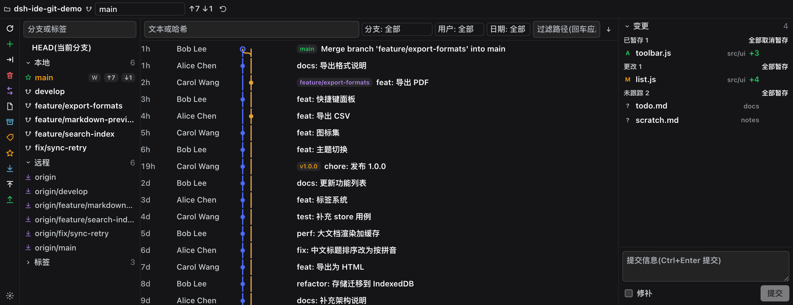
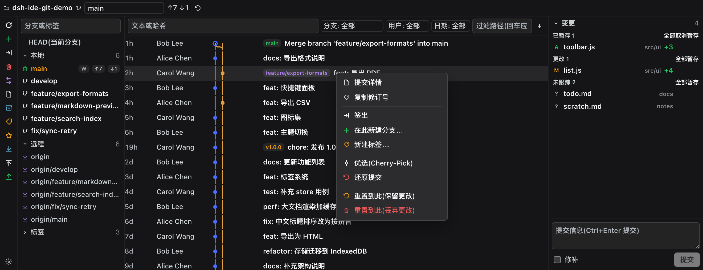
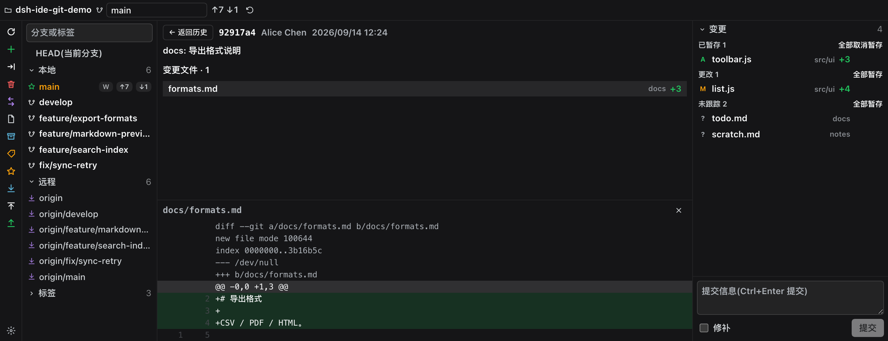
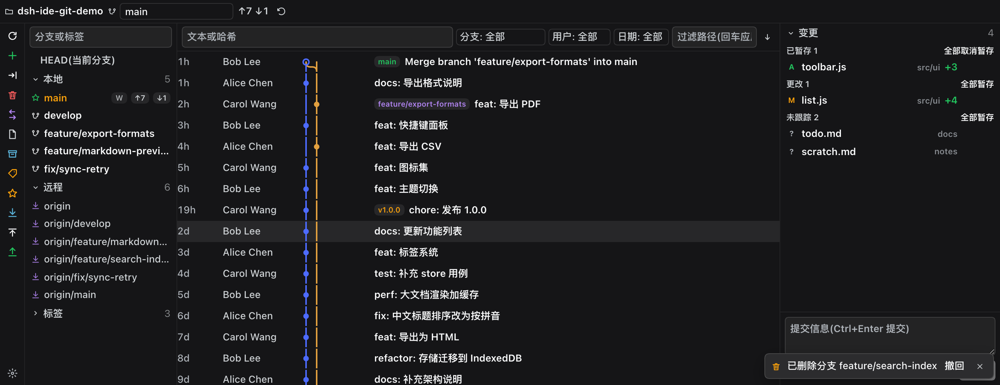
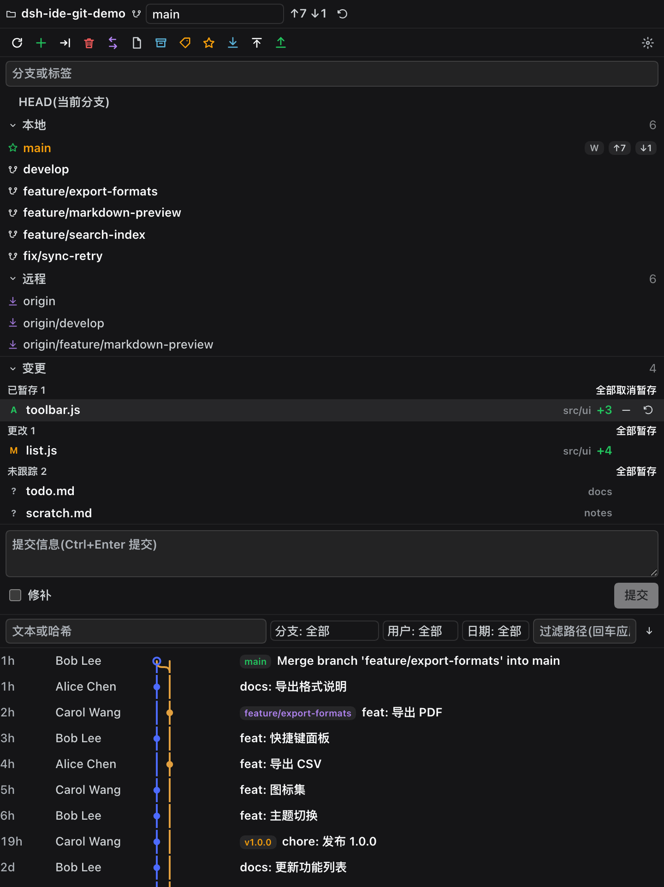
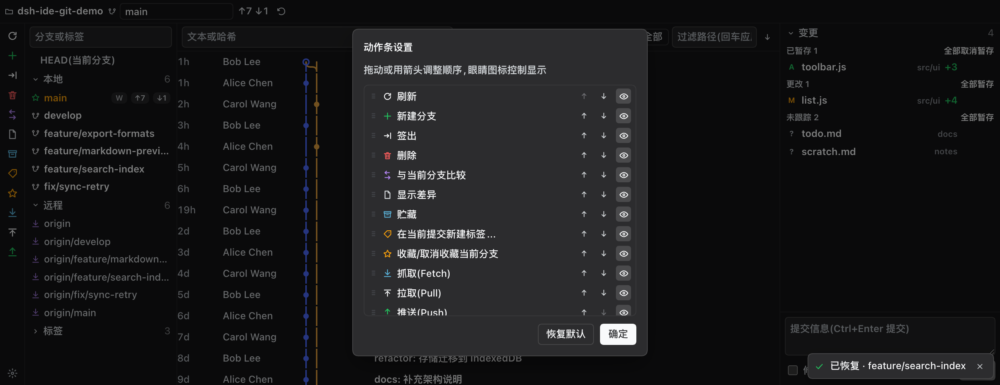

# dsh-ide-git

[](https://awesome-dsh-plugin.com)

[简体中文](README.md) | English

> An IDE-grade Git tool window for DeepSeek Harness: branch tree, commit graph, changes and commit box, and line-level diffs in one panel, with JetBrains-style actions.

DSH's built-in Git panel covers staging, committing, reverting, and history. This plugin brings in the Git tool window IDE users expect: a branch tree with context actions, a commit graph, commit details with line-level diffs, and a multi-repository overview. It registers as a native dsh-better-sidebar tab, mounts directly in DSH's own right sidebar, and since v0.13.0 can also live as a Git tab in the conversation area.

**Contents**

- [What it is](#what-it-is)
- [Install and open](#install-and-open)
- [Screenshots](#screenshots)
- [Core workflows](#core-workflows)
  - [Branches and history](#branches-and-history)
  - [Commits, diffs and references](#commits-diffs-and-references)
  - [Changes, staging and commits](#changes-staging-and-commits)
  - [All repositories](#all-repositories)
  - [Send to chat](#send-to-chat)
- [UI and settings](#ui-and-settings)
  - [Where it mounts](#where-it-mounts)
  - [Layout and action rail](#layout-and-action-rail)
  - [Git in the composer](#git-in-the-composer)
  - [Settings and diagnostics](#settings-and-diagnostics)
- [Compatibility and limits](#compatibility-and-limits)
  - [Compatibility](#compatibility)
  - [Interface language](#interface-language)
  - [Known limits](#known-limits)
- [Development](#development)
  - [Implementation](#implementation)
- [License](#license)

## What it is

It is a panel, not a set of commands. In a wide layout you get a branch tree on the left, a commit graph in the middle, and changes plus a commit box on the right; narrow containers switch to a vertical stack. The same panel appears in the right sidebar, the bottom workbench, or the conversation area, and adapts to the width it is given.

Compared with the built-in panel:

| Aspect | DSH built-in Git panel | dsh-ide-git |
|---|---|---|
| Scope | staging, committing, reverting, history | an IDE-style Git tool window |
| Branches | one dropdown | HEAD / local / remote / tag tree with context actions |
| History | a list | graph, scope switch, filters, rubber-band selection |
| Multiple repos | switch back and forth | an All repositories overview, one card per repo |
| Code references | none | send commits, branches, files, or diff lines to chat |

Both can coexist; this plugin does not replace the built-in panel.

## Install and open

Requires DSH `>=0.2.2-rc.1`. This release has been fully verified in the `web` profile only; the desktop client reuses the same renderer but has not been verified on a device (see Known limits).

```sh
dsh plugin --profile web add dsh-ide-git

# optional: bottom workbench + better-sidebar chrome
dsh plugin --profile web add dsh-better-sidebar

# restart dsh web
```

Open it:

- Plugin alone: session header → open right sidebar → the **Git** capsule on the Guide page.
- With better-sidebar: bottom panel `+` → **Git**; or native right sidebar `+` → **Git**. Same registration, same state.
- Conversation area: the **Git** tab next to Chat / Trajectory. Switch it off in plugin settings if you do not want it.

## Screenshots



*Bottom workbench: action rail on the left, commit graph in the middle, changes and commit box on the right.*

| | |
|---|---|
| <br/>**Commit context menu**: details, copy revision, checkout, new branch / tag, cherry-pick, revert, reset. | <br/>**Commit details**: full message, author / date, file list and line-level diff. |
| <br/>**Delete with undo**: a deleted branch or stash can be restored for 30 minutes. | <br/>**Right sidebar**: narrow and tall switches to the stacked layout. |

<details>
<summary>More screenshots</summary>



*Action rail settings: drag to reorder, show or hide each action.*

</details>

## Core workflows

### Branches and history

- **Branch tree**: four groups (HEAD, local, remote, tags), collapsible and filterable; each branch shows ahead/behind, upstream, and a `W` marker when checked out in another worktree. Local is blue, remote violet, tags amber, HEAD green.
- **History graph**: lane topology lines align across rows; HEAD is a hollow dot; refs show at most three badges, with the rest folded into `+n`. 120 commits per page, loading more at the bottom; the branch, commit, and file lists support rubber-band selection.
- **Scope**: switch history between the current branch, all branches, or any local or remote branch. Commits that are ahead on another branch do not disappear just because they are not on the current ancestry chain. Double-click a branch to browse its history without checking it out; when a merge connects the two, the view lands on the nearest merge point.
- **Filters**: text or hash, branch or tag, author (including Me), date (today / last 7 days / last 30 days / this year), newest/oldest toggle, and clear all. A path filter runs server-side as `git log -- <path>` after Enter.
- **Branch context menu**: checkout, rebase current onto this, merge this into current, compare, create from this branch, rename, delete, fetch, push, send to chat. Menu items and the merge button name both ends, for example "Rebase current master onto test" and "Merge test into current master"; a toast confirms when a rebase starts. Merge offers default / `--no-ff` / `--squash` / `--no-ff --no-commit`; compare reports by files and commits. A pending no-commit merge can be aborted from More → Commit → Abort merge.
- **Worktrees**: the Worktrees action lists the main and linked worktrees (current / main / locked / prunable, branch, short HEAD, path). You can create one (new branch or existing branch, optional start point), open it in the panel, copy its path, remove it (a second forced confirmation if it has uncommitted changes), and prune stale entries. It coexists with the official Change Requests panel.
- **Common actions**: the rail also has refresh, new branch, checkout, delete, compare, show diff, favourite, stash (list / save / apply / drop), tags, fetch, pull --ff-only, and push. Each button lights up or greys out with the current state, and hovering explains why it is unavailable.

### Commits, diffs and references

- **Commit list**: IDEA column order: date → author → graph → refs → subject. Dates are relative by default and can be absolute in settings.
- **Commit details**: full message, author / date, changed files with +/−, and a line-level diff per file (line numbers, hunk highlights, red/green backgrounds).
- **Commit context menu**: details, copy revision, checkout this revision (confirm), new branch here, new tag, cherry-pick, revert commit, reset here (keep / discard changes), send to chat.
- **Diff**: side-by-side / wrap, copy, drag to resize (height is remembered per placement); opens in the panel by default. Settings → Diff open location can be Git panel / right sidebar / bottom workbench; double-clicking a file then lands there. The inline header also has Open in right sidebar, and a multi-file patch follows the active file. The button is disabled with a reason when there is no right sidebar or the diff is still loading.
- **Path actions**: the full path in the diff header is split on `/` and highlights on hover. Right-click any directory segment to discard all changes under it or add it to `.gitignore` (untracked content only); the last segment handles the file itself.
- **Send selected lines to chat**: select text in a diff and right-click; see Send to chat for the exact formats.

### Changes, staging and commits

- **Changes list**: conflicted / staged / changes / untracked, with stage, unstage, and discard inline; group headers stage or unstage all; click a row for its diff.
- **Folder actions**: right-click a folder header to stage / unstage / discard / copy the path; add untracked content to `.gitignore` (conflicted files are excluded from bulk discard).
- **Commit box**: multi-line message, `Ctrl+Enter` (macOS `Cmd+Enter`) to commit, or commit and push; `--amend` amends the last commit. AI commit message can use a selected model; the model picker shows a badge.
- **File context menu**: show diff, open file in right sidebar, stage / unstage, discard, copy path, send to chat; untracked files can be added to `.gitignore`. File rows in commit details have the same show diff / open in right sidebar / send to chat actions.
- **Safety and undo**: deleting a branch or stash is real, but the object id is recorded first and a toast can undo it (one-shot, valid for 30 minutes); the top bar also has a recent-undo entry. Deleting `main` / `master` / `trunk` requires typing the branch name; unmerged commits need a second confirmation and force delete, and undo is still available. Destructive dialogs focus Cancel by default. Writes to the same repository run serially. When a merge / rebase / cherry-pick / revert / bisect is in progress, related actions are disabled with a reason.

### All repositories

The view button at the far left of the top bar switches between Current repository / All repositories. The default is Current repository, and the choice is remembered by the browser.

- One card per repository, with its own changes list, commit box, and diff: stage / unstage, discard (with an undo toast), AI commit message, amend, commit, commit and push, click a file for its diff, and the context menu. Every action applies only to that repository and does not change the repository bound to the session.
- Summary reads are capped at 2 concurrent requests; a write refreshes only its own card.
- A clean repository collapses to one row: "No uncommitted changes + Open repository". A failed card shows the reason and Retry.
- The top bar shows "N repositories · M changes". The left and right action rails are hidden in the overview; below 400px the grid is one column and the view button becomes icon-only.

### Send to chat

Commits, branches, files, and selected diff lines can be sent to the current session's composer from the panel. This uses DSH's official composer insertion path: existing text is not overwritten and the new content is appended. If a send is already in progress or the service is unavailable, it falls back to copying to the clipboard with a notice.

| Object | What is inserted |
|---|---|
| Commit | `git commit 47ad017 "Commit subject" (repo xxx)` |
| Branch | `git branch main (repo xxx)` |
| File | an `@path` file-reference chip, or a plain path; spaces are quoted |
| Selected diff lines | an `@file` chip plus line information; commits include the short hash / subject / branch, the working tree includes staged / unstaged |

Line numbers are mapped through diff hunks to the new file. Pure deletions use the old line number with a note. If the selection cannot be mapped to a diff line, it degrades to "Send selected snippet" (up to 600 characters) rather than inventing line numbers. The menu also offers **Copy selected reference**. With no selection, the browser context menu is left alone.

## UI and settings

### Where it mounts

| Host | Condition | What you get |
|---|---|---|
| **dsh-better-sidebar** | installed | a native right-sidebar tab plus the bottom workbench; the plugin appears under Sidebar cards in its settings |
| **DSH native right sidebar** | automatic when the host is absent | the **Git** capsule on the Guide page of the right sidebar → the same panel |
| **Conversation tab** | always available (can be disabled) | the **Git** tab next to Chat / Trajectory, turning the conversation area into a Git tool window |

The host, when present, wins. A late-arriving host replaces the native registration and mounts the panel there; the plugin still works without it.

### Layout and action rail

| Surface | Shape | Layout |
|---|---|---|
| Right sidebar (native or host-bridged) | narrow and tall | `stack`: changes on top, History / Diff tabs below; the branch tree can collapse |
| Bottom workbench (host-owned) | wide and flat | `columns`: branch tree · commit graph · changes and commit box |
| Sidebar dragged narrow (< 400px) | narrow | `compact`: changes on top, History / Diff tabs below |

The plugin does not guess where it is; it measures its container with `ResizeObserver`: width ≥ 600px and width ≥ height × 1.15 uses columns, width < 400px uses compact tabs, everything else uses the vertical stack. Width decides; height has no veto. Both vertical layouts put History / Diff in tabs; clicking a changed file switches to Diff; the divider can be dragged and double-clicked to reset. Free-floating windows and mobile drawers adapt the same way.

The action rail is a vertical strip on the left in the bottom workbench and a horizontal strip at the top in the right sidebar. It fits as many buttons as the space allows, folds the rest into `⋯`, and ends with `⚙` for reordering and visibility. Each button lights up or greys out with state; hovering a disabled button gives the reason. The status line shows the current branch, upstream, ahead/behind, stash count, and busy state. Hovering for 120ms shows the action name; the hint card is mounted at the window layer so the workbench cannot clip it.

### Git in the composer

The composer toolbar has repository / branch capsules with coloured counts for uncommitted, pullable, and unpushed changes. Clicking one opens a searchable switcher: repositories filter by name, path, clone directory, or current branch; branches fold on `/` into a folder tree, filter as you type, and support arrow keys + Enter. In a multi-repo workspace both sides switch, and the panel follows live; you can turn this off in settings (on by default).

The coloured change counts (`±N` / `+N −N`) are themselves a Show diff entry: click to open the Git panel on the first uncommitted file's diff; with no usable right sidebar the control is disabled with a reason. The switcher footer accepts an absolute path to add a repository outside the workspace and remembers the last 8 per session. The plugin prewarms the first screen when you switch to a new session.

### Settings and diagnostics

Settings include: panel placement (conversation tab on/off), diff open location (Git panel / right sidebar / bottom workbench), history date format, action rail order and visibility, composer status bar on/off, and the AI commit message model.

If the panel takes more than 2 seconds to load, a diagnostic bar appears: phase progress (fetch / summary / stats / branches / log), the active git subcommand and its elapsed time; if the host does not answer within 2.5 seconds it says Host not responding and offers a one-click copy of the diagnostic JSON. Normal loads and background polling do not show it.

## Compatibility and limits

### Compatibility

- Both `engines.dsh` and the `@deepseek-ai/dsh` peerDependency are `>=0.2.2-rc.1`, open-ended. Compatibility checks prefer `engines.dsh`; peer is a second declaration marked optional.
- Settings have one source of truth: `ctx.configForms` is the only entry point, and every row Config field can be written; old `localStorage` config is read only once during upgrade.
- Built on official public surfaces: the host side uses `webServer.register({ kind: 'prefix' })`, the client side uses the `window.__ModuleLoader__.load({ id, factory })` wrapper and the `slots` service; settings and dictionaries go through the official `configForms` / `locale` registries. Icons are its own SVG; file-type glyphs and the diff block optionally reuse the official `ui-primitives`, falling back to its own drawing when absent.
- `dsh-better-sidebar` is an optional peer: absent or broken, the plugin still mounts in the native right sidebar.

### Interface language

Follows DSH's `ctx.locale` live, with **21** dictionaries: Simplified and Traditional Chinese (including `zh-HK` / `zh-MO` / `zh-TW`), English, Japanese, Korean, German, French, Italian, Portuguese, Russian, Dutch, Polish, Swedish, Turkish, Indonesian, Vietnamese, Thai, Hindi, and Arabic. The dictionaries are also registered in DSH's locale registry (`ctx.get('locale').register(...)`).

Resolution is exact tag → primary language subtag → English; English is always the complete key set. Any uncovered language falls back to English, never to raw keys. The dictionaries live in the `LOCALES` table in `src/client.js`, and the smoke test enforces that every dictionary has exactly the same keys as Chinese.

### Known limits

- Not yet: multi-select and bulk actions in the changes list, per-file partial commits (changelists), interactive rebase (`rebase -i`) / fixup / squash, patches (`format-patch` / `apply`), a three-way merge conflict editor, blame / file history.
- The desktop client reuses the same renderer, but this release has not been verified on a desktop device.
- Large repositories: 120 commits per page, diff output capped at 400KB (truncated and marked).
- The plugin never edits files inside `.git` directly; every operation goes through `git` with the normal index and refs.

## Development

```sh
npm test                  # smoke (file-level invariants) + api (real temp repos driving host routes)
node scripts/ssr-check.mjs
node scripts/layout-probe.mjs
node scripts/demo-repo.mjs
node scripts/screenshots.mjs
```

- `npm test` covers manifest consistency, the client wrapper, allowlists, confirmation guards, the method table, and parsing, staging, committing, branches, tags, stash, all guards, and the trust fence on temporary repositories.
- `ssr-check.mjs` is the server-rendered smoke test for the panel; `layout-probe.mjs` checks layout, overflow, and page errors from 1600px down to 380px; `demo-repo.mjs` builds the fictional repository used for screenshots, and `screenshots.mjs` reproduces the images in this README.
- Local development: add the repository to the web profile and restart `dsh web`; client-side changes hot-reload, host-side changes need a restart.

### Implementation

```
Host side src/index.js                     Client side src/client.js
  POST /dsh-ide-git/api/<method>            ctx.betterSidebar.registerTab({ id: 'dsh-ide-git:panel' })
  └─ spawn('git', argv, { cwd })            └─ Panel:ResizeObserver → columns / stack
     └─ session workspace = cwd (from client scope.cwd)
```

- **Host side**: one prefix route `/dsh-ide-git/api`; the method table covers `summary` / `changes` / `branches` / `log` / `commitDetail` / `diff` / `compare` / `stage` / … / `push` / `tagDelete` / `version`. Every git call is an argv array with `spawn`: no shell strings and no `exec`. Arguments are validated first (absolute paths, refs not starting with `-`, no control characters, paths inside the repository).
- **Client side**: no build step, one file, wrapped in `window.__ModuleLoader__.load({ id, factory })`; it requires `react` and optionally reuses the official `@deepseek-ai/dsh-client-ui-primitives` file-type glyphs and diff block, falling back to its own drawing when absent.
- **Trust fence**: the routes live on DSH's own web server, so they are same-origin by construction; only requests with a loopback Host, or a browser-marked `Sec-Fetch-Site: same-origin/same-site`, are served.
- **Destructive operations**: `push` / hard reset / force branch delete / discard untracked files / drop stash require an explicit `confirm: true`, and the UI always asks a second time.

## License

MIT © KannaKuron
